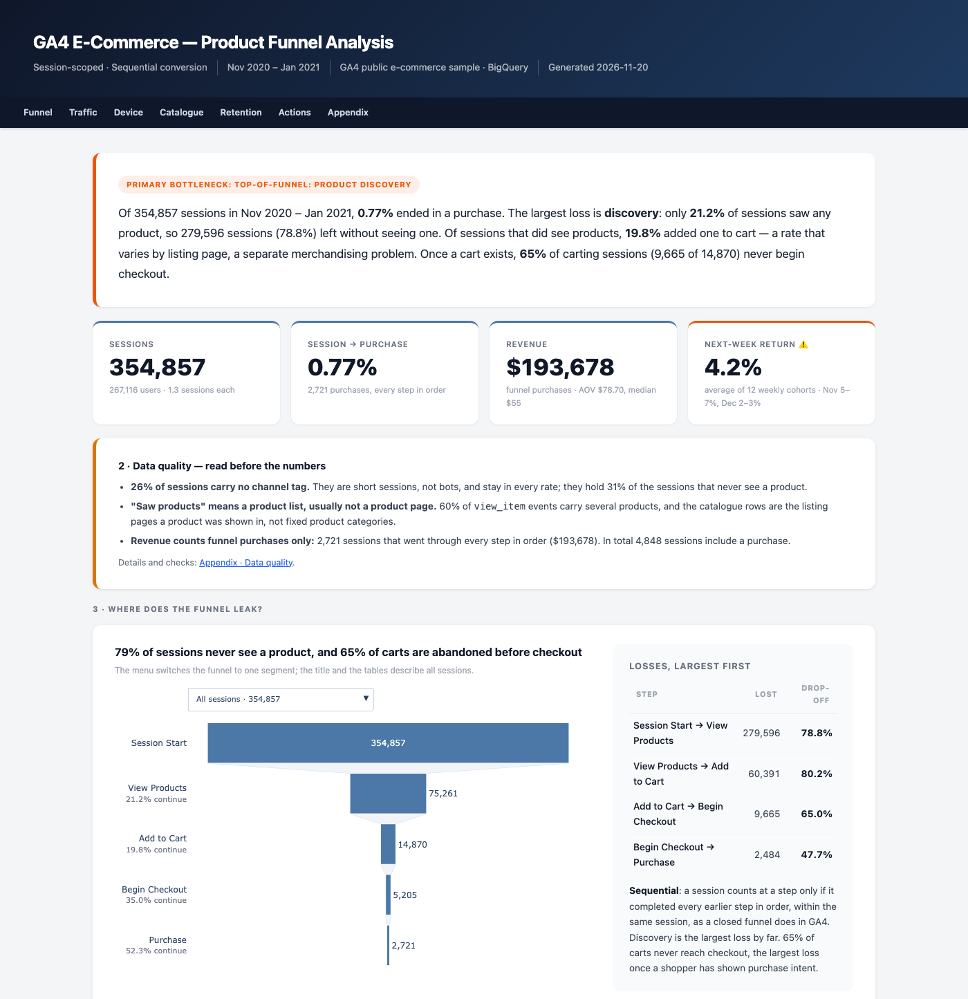

# GA4 Product Funnel Analysis

**Question:** only 0.77% of the Google Merchandise Store's sessions end in a purchase — where is the funnel losing people, and what should the team fix first?
**Answer:** 79% of sessions never see a product — leaning a site problem rather than a traffic one — and three landing pages whose visitors leave at once are the first fix; after that, 65% of carts are abandoned before checkout.

[](https://github.com/guiarpi/ga4-product-analytics/actions/workflows/tests.yml)

**[→ View the live interactive dashboard](https://guiarpi.github.io/ga4-product-analytics/dashboard.html)**

[](https://guiarpi.github.io/ga4-product-analytics/dashboard.html)

A product-analytics study of Google's public GA4 BigQuery export (Nov 2020 – Jan 2021): SQL in BigQuery, metrics and statistics in pandas and SciPy, an interactive dashboard, and an LLM-written product brief whose every number traces back to the computed results.

---

## Key findings

From 354,857 sessions in the [public obfuscated GA4 sample](https://console.cloud.google.com/bigquery?p=bigquery-public-data&d=ga4_obfuscated_sample_ecommerce). The rates and the method transfer; the absolute figures are illustrative.

- **Discovery is the largest loss.** Only 21.2% of sessions see any product; 279,596 sessions (78.8%) leave without seeing one. Session-to-purchase conversion is 0.77%.
- **Leaning site, not traffic — but borderline.** Every channel loses at least 70% of its sessions before a product. Product reach runs from 21.6% (cpc) to 30.3% (referral), an 8.7pp spread against a 10pp decision threshold.
- **Three landing pages are the concrete target — and a fourth was a tracking gap.** Four pages take 76,426 landings (22% of sessions) and show a product to 8.9–11.8% of them, against 21.2% site-wide. Diagnosed week by week: the Apparel and Drinkware listings and `store.html` work for visitors who reach them from inside the site (25.7–35.2% see a product), but landing visitors leave at once and 62% of them carry no channel tag — the gap is in who lands there. On the Dino Game Tee page, `view_item` was silent from 30 Nov to 17 Jan while visitors behaved as usual: a measurement gap, not lost views. Bringing the three real pages to the site rate is worth ~253 orders, **$9.0k–$18.0k** over the window.
- **Most carts are abandoned.** 65% of carting sessions (9,665 of 14,870) never begin checkout — the largest loss once a shopper has shown purchase intent.
- **Six product-type listing pages cart below average.** Against a 22.1% product-type average, 6 of 12 sit below with 95% confidence; Bags, Women's and Men's / Unisex hold 1,054 of the 1,635 carts at stake. Price is a confounder: items at $10–20 are carted at 12.2%, items at $30–50 at 6.3%.
- **Return visits fell in December, in every channel.** Next-week return averages 4.2%, from 5.0–6.7% for November cohorts to 2.4–3.3% for December. A change in channel mix explains only 7% of the fall, so the likelier reading is seasonal, not lower-intent traffic.
- **Returning sessions buy at 4.1× the rate of new ones** (1.69% vs 0.42%) — partly self-selection, so re-engaged users are sized between the two rates.
- **Device is not the lever:** purchase rates differ by 0.05pp across desktop, mobile and tablet (χ² p = 0.259).

---

## The analysis, section by section

The notebook, the dashboard and this README share one numbering: one question per section, answer first.

| # | Question | What is computed |
|---|---|---|
| 1 | **Setup and data** | Config, date range, event inventory |
| 2 | **Data quality — read before the numbers** | What untagged sessions are (short, not bots); `view_item` as a list impression; why `session_start` events (354,970) exceed sessions (354,857): 113 repeated starts in 105 sessions |
| 3 | **Where does the funnel leak?** | The sequential session funnel, revenue, landing pages with a page / tracking / entry-traffic diagnosis, time to convert |
| 4 | **Is it the traffic?** | The funnel by the session's own channel, with a chi-square test and Cramér's V |
| 5 | **Is it the device?** | The funnel by device, with Wilson intervals and a chi-square test |
| 6 | **Where in the catalogue?** | Shoppers funnel; seen → carted by product-type listing page (flagged only when the whole 95% interval is below average); price bands |
| 7 | **Do they come back?** | Weekly cohort retention (censored cells blank, partial first week excluded), its trend split into channel mix and within-channel change, new vs returning |
| 8 | **What should we do?** | Three recommendations in one format: problem, action, sized revenue, metric and target, confidence, main risk |
| 9 | **AI-written product brief** | The computed results and verdicts, as JSON, to an LLM; the brief is checked against them and embedded in the dashboard |

The dashboard is static HTML with interactivity: a funnel segment menu (all, excluding untagged, new, returning, each device, each channel), a revenue-opportunity calculator, sort and view toggles, sortable tables and collapsible caveats.

---

## Limitations

- **Obfuscated public sample.** Google masks or deletes some values (`<Other>`, `(data deleted)`, `(not set)`); findings need validation on production data.
- **No session-level traffic-source fields in the 2020 schema.** The session's channel is taken from the `medium` event parameter; 26% of sessions carry none. It agrees with GA4's user-level first-touch medium in only 52.9% of sessions.
- **Price, but no cost or margin.** Item list prices are present and used for the price bands; there is no cost, margin, discount or stock data, so revenue is not profit.
- **Untagged and very short sessions.** 26% of sessions have no channel tag and 26,132 have no `page_view`. The checks in Section 2 show they behave like ordinary short sessions rather than bots, but GA4's own bot filtering cannot be inspected.
- **No user-ID stitching.** `user_pseudo_id` is a cookie: a person on two devices, or who clears cookies, counts as two users, so "new" sessions and next-week return are understated for real people.
- **Listing pages, not product categories.** `item_category` records where a product was shown (414 of 420 products appear under more than one), and 37% of `view_item` events carry no items at all.
- **Session-scoped funnel.** 2,127 purchasing sessions fall outside the sequential funnel, most because the cart was filled in an earlier visit; 260 funnel purchases record no revenue.
- **The AI brief is not deterministic.** Each run can word things differently. The prompt forbids contradicting the computed verdicts and the run is checked so that every number in the brief appears in the context it was given, but the dashboard's computed sections are the source of truth.

---

## Metric glossary

| Term | Meaning here |
|---|---|
| **Session** | One (`user_pseudo_id`, `ga_session_id`) pair. |
| **Sequential conversion** | A session counts at a step only if it reached every earlier step in order, within the same session — as a closed funnel does in GA4. |
| **Saw products** | The session has a `view_item` event; in this export that is mostly a product list, not a product page. |
| **Listing page** | The `item_category` a product was shown under: a product type (Hats), brand (Google), collection (Sale) or parent page (Apparel). |
| **Seen → carted** | Of sessions that saw a listing page's products, the share that carted one of them (the item with a quantity) after the first sighting. |
| **Site average / product-type average** | Pooled, volume-weighted rate across the rows being compared. Internal comparisons only — no external benchmarks are used. |
| **Carts at stake** | Extra carting sessions a listing page would gain at the average rate; counted only for pages whose whole 95% interval is below it. |
| **Next-week return (Week-1)** | Share of a weekly cohort with any session in the next Monday-anchored calendar week — a 1–13-day window. Close to D7 retention, but not the same. |
| **Unattributed / untagged session** | A session with no `medium` on any event, shown as `(not set)` in channel tables. |
| **New vs returning** | New when GA4's `ga_session_number` is 1 (first session on that cookie ever), otherwise returning. |
| **95% interval** | Wilson score interval on a rate; flags and "significant" use it, sizes use the point estimate. |

---

## What's in this project

| File | Description |
|---|---|
| `ga4_funnel_analysis.ipynb` | The analysis, Sections 1–9, with every query shown and each chart saved as a static image so it renders on GitHub |
| `dashboard.html` | The interactive dashboard — [live on GitHub Pages](https://guiarpi.github.io/ga4-product-analytics/dashboard.html), or open the file locally; works offline |
| `generate_dashboard.py` | Runs the queries, computes every number and verdict, renders `dashboard.html` (`--dry-run` estimates the bytes each query would scan) |
| `queries.py` | All SQL, shared by the notebook and the dashboard |
| `metrics.py`, `stats_utils.py` | Pure calculations: flags, carts at stake, listing levels, landing-page targets, mix decomposition; Wilson intervals, chi-square, Cramér's V |
| `charts.py` | Plotly figures, shared by the notebook and the dashboard |
| `templates/` | The page (Jinja2): layout, CSS and the narrative's conditional wording |
| `md_render.py` | Escapes and renders the AI brief's markdown for the page |
| `config.py` | Project, dataset, date window and query cost cap — all overridable with environment variables |
| `tests/` | pytest suite — no BigQuery, credentials or network needed |
| `.github/workflows/tests.yml` | CI: lint and tests on Python 3.11–3.13 |
| `requirements.txt`, `requirements-dev.txt`, `requirements-lock.txt` | Dependencies as ranges; test tools; the exact versions behind the committed outputs |
| `product_brief_ga4_funnel.md`, `product_brief_context.json` | The AI brief and the exact context it was written from — generated by Section 9, gitignored |
| [`docs/DASHBOARD_GUIDE.md`](docs/DASHBOARD_GUIDE.md) | Runbook: regenerate, check, publish and adapt the dashboard |
| [`docs/future_enhancements.md`](docs/future_enhancements.md) | Roadmap, including a planned Power BI version (E7) |
| `index.html`, `.nojekyll`, `assets/` | GitHub Pages plumbing and the README screenshot |
| `LICENSE` | MIT |

---

## How to run

### Prerequisites

- Python 3.11 or later. The committed outputs were produced on Python 3.13; CI tests 3.11, 3.12 and 3.13.
- A Google Cloud project with the BigQuery API enabled; the public dataset is readable from any project.
- For the notebook's static chart images: [kaleido](https://pypi.org/project/kaleido/) and a local Chrome. Without them the charts stay interactive only.

### Install and authenticate

```bash
pip install -r requirements.txt
gcloud auth application-default login     # Application Default Credentials — no key file
```

`requirements.txt` lists version ranges. To reproduce the committed outputs exactly, install the pinned versions they were produced with instead — Python 3.13, recorded in `requirements-lock.txt`:

```bash
pip install -r requirements-lock.txt
```

### Set your project (and optionally your own data)

Nothing needs editing in code: `config.py` reads its settings from environment variables, shared by the notebook and the dashboard script.

```bash
export GA4_PROJECT_ID="your-gcp-project-id"   # runs (and pays for) the queries
```

If unset, it falls back to `GOOGLE_CLOUD_PROJECT`, then to your `gcloud` default project. The dataset and dates default to Google's public GA4 sample (Nov 2020 – Jan 2021). To run on your own GA4 export instead:

```bash
export GA4_DATASET="your-project.analytics_123456789"
export GA4_DATE_START="20240101"   # YYYYMMDD, inclusive
export GA4_DATE_END="20240331"
```

Every query runs under a cost cap of 5 GB billed per query: BigQuery refuses, without charging, any query that would bill more. On the public sample the largest query scans about 1.6 GB, and a full dashboard run about 17 GB. A larger export may need a higher cap, and you can see what a run would scan before running it:

```bash
python generate_dashboard.py --dry-run     # free estimate per query; runs nothing
export GA4_MAX_BYTES_BILLED="20GB"         # raise the per-query cap if needed
```

Invalid values are rejected before any query runs. On your own data, review the dashboard's "About this dataset" block and the recommendation text, which describe the public sample.

### Run the notebook

```bash
jupyter notebook ga4_funnel_analysis.ipynb
```

Restart the kernel and run all cells. Sections 1–8 need no API key. Section 9 writes the AI brief with an LLM — choose one:

- **Anthropic Claude (paid):** `export ANTHROPIC_API_KEY=...` — key from [console.anthropic.com](https://console.anthropic.com).
- **Google Gemini (free tier):** `export GEMINI_API_KEY=...` and `pip install google-genai` — key from [aistudio.google.com](https://aistudio.google.com). Used only when Claude produced no brief. The default model is `gemini-3.5-flash`; override with `GEMINI_MODEL` ([current models](https://ai.google.dev/gemini-api/docs/models)).
- **Neither:** Section 9 is skipped; the committed dashboard keeps the brief it already embeds.

Keys are read from environment variables only — never paste one into the notebook, whose outputs are committed.

### Generate the dashboard

```bash
python generate_dashboard.py
```

Writes `dashboard.html`, a self-contained file (~5 MB, plotly.js embedded). If `product_brief_ga4_funnel.md` exists it is embedded, and flagged on the page if it was written from an older version of the analysis.

### Run the tests

```bash
pip install -r requirements.txt -r requirements-dev.txt
python -m pytest -q
```

The suite checks the SQL builders, statistics, flags, chart menus, templates and config validation, with no BigQuery access, credentials or network. GitHub Actions runs it with a pyflakes lint on every push and pull request.

---

## SQL patterns used

| Pattern | Where |
|---|---|
| `(SELECT value.int_value FROM UNNEST(event_params) …)` | Session ID, medium, page path and engagement from the nested parameters |
| Sequential step flags (`ts_v >= ts_s AND …`) | Enforcing step order within a session |
| `_TABLE_SUFFIX BETWEEN` | Partition pruning: only the window's daily tables are scanned |
| `FROM events_*, UNNEST(items)` | Item-level grain for listing pages and price bands |
| `ARRAY_AGG(x IGNORE NULLS ORDER BY ts, x LIMIT 1)` | A session's first medium and landing page, deterministically |
| `GROUP BY GROUPING SETS` | Several data-quality splits from one scan |
| `PERCENTILE_CONT` / `PERCENTILE_DISC` windows | Exact medians, so every run gives the same page |
| `DATE_TRUNC(…, WEEK(MONDAY))` | Weekly cohort bucketing |
| `maximum_bytes_billed`, dry runs | Per-query cost cap and free size estimates |

All SQL is BigQuery Standard SQL and lives in `queries.py`.

---

## B2B SaaS translation

The funnel and retention logic carry over to product events; the event names, the session definition and the retention window need to be mapped to the product's own.

| GA4 event | SaaS analogue |
|---|---|
| `session_start` | Login / app open |
| `view_item` | Reaching a core feature |
| `add_to_cart` | First attempt at the core action |
| `begin_checkout` | Starting the key workflow, e.g. creating a first record |
| `purchase` | Activation — completing the key value moment |
| Next-week return | Early retention — closest to D7, but a calendar-week measure (1–13 days) |

---

## Tech stack

- **BigQuery** — Standard SQL on the GA4 export schema; partition pruning, cost cap, dry runs
- **Python** — pandas, SciPy (Wilson intervals, chi-square), google-cloud-bigquery
- **Plotly** — interactive charts; kaleido for the notebook's static images
- **Jinja2** — the dashboard page, autoescaped
- **Anthropic API / Google Gemini** — the AI-written brief (Gemini free tier supported)
- **pytest, pyflakes, GitHub Actions** — tests and lint on every push
- **GitHub Pages** — hosts the dashboard
