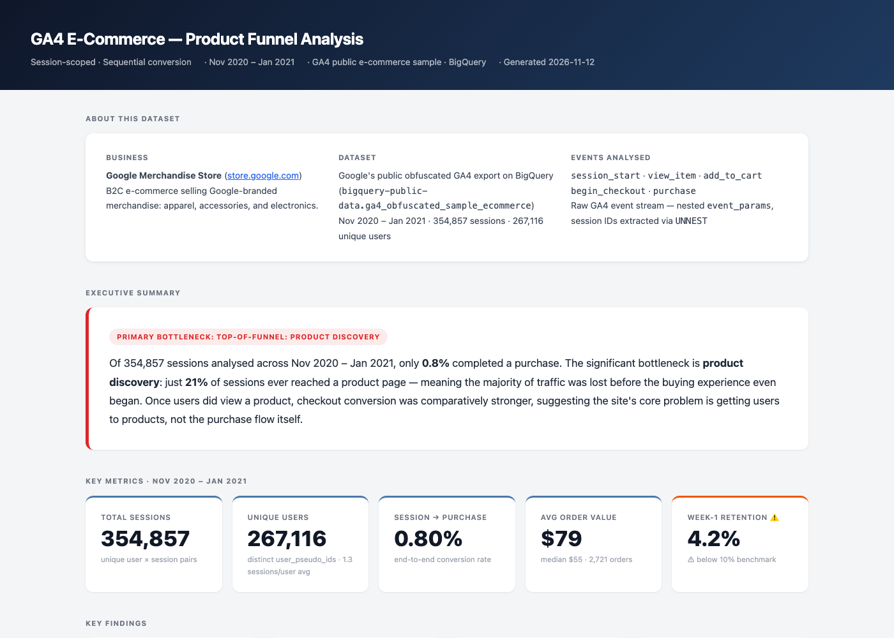

# GA4 Product Funnel Analysis

End-to-end product analytics project built on Google Analytics 4 (GA4) data in BigQuery. Covers session-scoped funnel analysis, revenue metrics, device and acquisition-channel segmentation, product-category conversion, time-to-convert, shoppers funnel, weekly cohort retention, and an AI-generated product brief — all in Python.

**Dataset:** [`bigquery-public-data.ga4_obfuscated_sample_ecommerce`](https://console.cloud.google.com/bigquery?p=bigquery-public-data&d=ga4_obfuscated_sample_ecommerce) · Nov 2020 – Jan 2021

**[→ View the live interactive dashboard](https://guiarpi.github.io/ga4-product-analytics/dashboard.html)**

[](https://guiarpi.github.io/ga4-product-analytics/dashboard.html)

---

## What's in this project

| File | Description |
|---|---|
| `ga4_funnel_analysis.ipynb` | Main analysis notebook — all SQL, charts, and commentary |
| `generate_dashboard.py` | Runs all queries and produces a standalone `dashboard.html` |
| `dashboard.html` | Self-contained interactive dashboard (plotly.js embedded) — [live on GitHub Pages](https://guiarpi.github.io/ga4-product-analytics/dashboard.html), or open locally, works offline |
| `index.html`, `.nojekyll` | GitHub Pages plumbing: redirect the site root to the dashboard, skip the Jekyll build |
| `assets/dashboard-preview.png` | README screenshot of the dashboard |
| `product_brief_ga4_funnel.md` | AI product brief written by Section 10 of the notebook — generated locally, gitignored |
| `requirements.txt` | Python dependencies |
| `future_enhancements.md` | Roadmap of next steps, with effort estimates and what is deliberately out of scope |
| `DASHBOARD_GUIDE.md` | How to regenerate, QA, publish and adapt the dashboard |
| `POWERBI_GUIDE.md` | Plan for a Power BI version of the analysis (not yet built) |
| `LICENSE` | MIT |

---

## Analysis overview

### 1 · Session-scoped funnel
Converts the GA4 event stream into a sequential 5-step funnel: **Session Start → View Item → Add to Cart → Begin Checkout → Purchase**. Each session is counted at a step only if it completed all prior steps in order within the same session — matching how the GA4 UI calculates funnel conversion and avoiding the inflation caused by carrying past-purchase behaviour into new sessions.

The grain is `(user_pseudo_id, ga_session_id)`. Session IDs are extracted from the nested `event_params` array using `UNNEST`.

### 2 · Revenue metrics
Total revenue, average order value, and median order value for converting sessions. The mean/median gap surfaces revenue concentration from high-value orders.

### 3 · Device breakdown
The same sequential funnel split by `device.category` (desktop, mobile, tablet). Used to assess whether device type is a meaningful driver of conversion loss.

### 4 · Acquisition channel breakdown
The same funnel split by channel, to decide whether the ~79% "never views a product" loss is a **site** problem (uniform across channels) or a **traffic-quality** problem (concentrated in some). A 10pp spread in session → view-item rate is the decision threshold, and the dashboard's conclusion flips on it.

Channel is the session's own `medium` from `event_params`, not `traffic_source.medium` — the latter is the user's **first-touch** medium and would attribute every returning session to the campaign that first acquired the user. The notebook quantifies how often the two disagree.

### 5 · Product category view → cart
Ranks `item_category` by view → add-to-cart rate using `UNNEST(items)`, at (session, category) grain. Categories are prioritised by **carts at stake** — the extra carting sessions if a category converted at the volume-weighted benchmark — so a high-traffic category with a moderate gap outranks a niche one with a dramatic rate. This turns "audit the product pages" into a ranked starting list.

GA4's `item_category` mixes flat labels (`Bags`) with paths (`Lifestyle/Bags/`), so labels are normalised to their last path segment in SQL — before the per-session grouping, so a session that viewed both counts once — and every merge is listed for review in the notebook.

### 6 · Time-to-convert
Median time (in hours) between each funnel step, using `APPROX_QUANTILES` on microsecond-precision event timestamps. Restricted to sessions that completed the full funnel, so this measures deliberation time for buyers, not abandonment.

### 7 · Shoppers funnel
An alternative funnel starting at `view_item` — isolating users who demonstrated product intent. Separating this from the full-session funnel reveals the true add-to-cart rate among engaged users and sizes the product discovery gap.

### 8 · Weekly cohort retention
Users grouped by the week of their first session, tracked week-over-week. The heatmap shows what percentage of each cohort returned in subsequent weeks. Analogous to D7/D14 retention in a SaaS context.

### 9 · AI product brief (Section 10 of the notebook)
Structured analysis context is passed to an LLM to generate a product brief with: executive summary, key findings, hypotheses, recommended actions, and metrics to track next. Demonstrates AI-augmented analysis beyond chart generation.

The committed `dashboard.html` already embeds a pre-generated brief, so it renders fully without an API key. The markdown file itself is generated output and gitignored — to produce it, see the API key setup options below.

---

## Key findings

From 354,857 sessions (Nov 2020 – Jan 2021, public obfuscated sample — the rates and method transfer, the absolute figures should not be quoted as benchmarks):

- **78.8% of sessions never reach a product page** (279,596 visits) — the dominant loss, upstream of everything else. Session-to-purchase conversion is 0.80%.
- **Discovery, not the product page, is the gap:** 19.7% of product viewers add to cart, against 4.2% of all sessions.
- **The leak is mostly on the site, not in the traffic — but it is borderline.** Product-page reach ranges from 21.6% (cpc) to 30.3% (referral), an 8.7pp spread against a 10pp decision threshold. Channel is the session's own medium; it agrees with GA4's first-touch `traffic_source.medium` in only 52.9% of sessions. 26.2% of sessions carry no session-level medium and reach a product page at just 6.7% — a block worth investigating on its own.
- **Three categories hold most of the product-page opportunity.** Against a 25.0% volume-weighted view → cart benchmark, YouTube (15.6%), Apparel (19.1%) and Bags (17.6%) account for 1,185 of the 2,157 carts at stake across the 23 ranked categories.
- **Sizing:** a 5pp lift in session → product-page rate is worth ~641 orders — $25K–$50K at the $79 AOV, depending on how well incremental traffic converts.
- **Buyers are quick, but few return:** median session-to-purchase time is ~16 minutes; Week-1 retention averages 4.2% (full cohorts only, right-censored weeks excluded).
- **Device is not the lever:** purchase rates differ by 0.05pp across desktop, mobile and tablet.

---

## How to run

### Prerequisites

- Python 3.9+
- A Google Cloud project with BigQuery API enabled
- Access to `bigquery-public-data` (available to all GCP accounts)

### Install dependencies

```bash
pip install -r requirements.txt
```

### Authenticate with Google Cloud

This project uses [Application Default Credentials](https://cloud.google.com/docs/authentication/application-default-credentials) — no service account key file needed.

```bash
gcloud auth application-default login
```

### Set your project ID

In both `ga4_funnel_analysis.ipynb` and `generate_dashboard.py`, update:

```python
PROJECT_ID = "your-gcp-project-id"
```

### Run the notebook

```bash
jupyter notebook ga4_funnel_analysis.ipynb
```

Run all cells in order. Sections 1–9 have no API key dependency. Section 10 (AI brief) requires an LLM API key — choose one:

**Option A — Anthropic Claude (paid, ~$0.01 per run)**
```bash
export ANTHROPIC_API_KEY="sk-ant-..."
```
Get a key at [console.anthropic.com](https://console.anthropic.com) → API Keys.

**Option B — Google Gemini (free, no credit card)**
```bash
export GEMINI_API_KEY="AIza..."
pip install google-genai
```
Get a free key at [aistudio.google.com](https://aistudio.google.com) → "Get API key". Leave `ANTHROPIC_API_KEY` unset and run Section 10 as normal — **Section 10e** uses Gemini only when 10d produced no brief. The default model is `gemini-3.5-flash`; model IDs change often, so override it with `export GEMINI_MODEL="..."` (current list: [ai.google.dev/gemini-api/docs/models](https://ai.google.dev/gemini-api/docs/models)).

**Option C — Skip (dashboard still works)**
The committed `dashboard.html` already contains a pre-generated brief. If you regenerate the dashboard without `product_brief_ga4_funnel.md` present, the brief section is simply omitted.

### Generate the dashboard

```bash
python generate_dashboard.py
```

Opens as `dashboard.html` — a fully self-contained file (~5 MB, plotly.js embedded) with no runtime or network dependencies. If `product_brief_ga4_funnel.md` exists (generated in Section 10 of the notebook), it will be embedded in the dashboard automatically.

---

## SQL patterns used

| Pattern | Where |
|---|---|
| `UNNEST(event_params)` scalar subquery | Extracting `ga_session_id` from the nested array |
| Sequential `COUNTIF` chain | Enforcing step order within a session |
| `APPROX_QUANTILES` | Efficient percentile computation for time-to-convert |
| `DATE_TRUNC(..., WEEK(MONDAY))` | Weekly cohort bucketing |
| `_TABLE_SUFFIX BETWEEN` | Partition pruning to control BigQuery costs |
| `FROM events_*, UNNEST(items)` | Item-level grain for the product category analysis |
| `ARRAY_AGG(x ORDER BY ts LIMIT 1)[OFFSET(0)]` | First non-null session medium across a session's events |

All SQL is written for **BigQuery Standard SQL** and runs against the public GA4 sample dataset with no modifications.

---

## B2B SaaS translation

The funnel events map directly to SaaS product analytics concepts:

| GA4 event | SaaS equivalent |
|---|---|
| `session_start` | User login / app open |
| `view_item` | Feature discovery — navigating to a core feature |
| `add_to_cart` | Feature first use — attempting the core action |
| `begin_checkout` | Workflow initiated — e.g. creating a first record |
| `purchase` | Activation — completing the key value moment |
| Week-1 retention | D7 retention after first login |

The SQL patterns, funnel methodology, and retention framework apply without modification to any event-based product analytics dataset.

---

## Tech stack

- **Python** — pandas, Plotly, google-cloud-bigquery
- **BigQuery** — Standard SQL, partitioned `events_*` tables, GA4 export schema
- **Plotly** — Interactive charts rendered to standalone HTML
- **Anthropic API / Google Gemini** — LLM for AI-generated product briefs (Gemini free tier supported)
